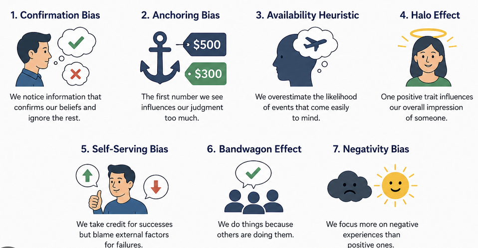

### Non-science Stuffs

Cognitive biases and psychological effects which have been studied and are academically accepted:
##### 1. **Dunning-Kruger Effect:**
- **Description:** This cognitive bias occurs when individuals with low ability or knowledge in a particular area overestimate their own competence. Conversely, individuals with high ability tend to underestimate their competence.
- **Implications:** It highlights the need for self-awareness and accurate self-assessment in various fields, including education and professional development.

##### 2. **Placebo Effect:**
- **Description:** The placebo effect occurs when a person experiences a real improvement in their condition after receiving a treatment that has no therapeutic effect. This is due to their belief in the treatment’s efficacy.
- **Implications:** It is significant in clinical trials and medical treatments, underscoring the power of expectations and beliefs on health outcomes.

##### 3. **Confirmation Bias:**
- **Description:** This bias involves favoring information that confirms one’s preexisting beliefs or hypotheses while disregarding or minimizing contradictory information.
- **Implications:** It affects decision-making, critical thinking, and scientific research, emphasizing the importance of objective analysis and openness to new information.

##### 4. **Halo Effect:**
- **Description:** The halo effect is a type of cognitive bias where the perception of one positive characteristic of a person influences the perception of their other characteristics. For example, an attractive person might also be perceived as intelligent and kind.
- **Implications:** It affects judgments in various contexts, such as hiring decisions, academic evaluations, and social interactions.

##### 5. **Self-Serving Bias:**
- **Description:** This bias involves attributing positive events to one’s own actions and abilities, while attributing negative events to external factors.
- **Implications:** It influences self-perception and interpersonal relationships, impacting how individuals interpret successes and failures.

##### 6. **Pygmalion Effect (Rosenthal Effect):**
- **Description:** This effect occurs when higher expectations lead to an increase in performance. For example, teachers’ expectations about their students can influence the students’ actual performance.
- **Implications:** It demonstrates the power of expectations and perceptions in educational and workplace settings.
- **Note:** Pygmalion is based on greek sculptor's namesake who was so infatuated with his own sculpture that it came to life. The opposite of pygmalion is Golem effect, where lower expectations lead to a decrease in the performance.

##### 8. **Anchoring Effect:**
- **Description:** The anchoring effect occurs when individuals rely too heavily on the first piece of information encountered (the "anchor") when making decisions. Subsequent judgments are influenced by this initial information.
- **Implications:** It is relevant in negotiations, pricing strategies, and decision-making processes, illustrating the impact of initial information on final outcomes. 
###### Example: 
When ppl see a reduced price, they tend to buy it even if the reduced price is still significantly higher. Or a manager can call off a project on previous poorer performance. 

{source:https://behaviorfacts.com/}

##### 9. **Barnum effect:** 
The Barnum Effect is a psychological phenomenon where individuals believe that vague, general statements about personality specifically apply to them, even though these statements are actually applicable to a wide range of people. This effect explains why people often find personal horoscopes, fortune-telling, and certain personality tests highly accurate and tailored to them personally, even though the statements are broad enough to apply to almost anyone.
1. **General Statements:** The statements are crafted to be general and positive, making it easy for individuals to see themselves in them.
2. **Personal Validation:** People tend to accept these statements as personally meaningful and accurate.
3. **Applications:** Used in horoscopes, astrology, fortune-telling, and some personality assessments to make them seem more credible and personalized.
##### Example:
- A horoscope might say, "You have a great need for others to like and admire you, and you have a tendency to be critical of yourself." Most people can see themselves in this description, which is why they believe the horoscope is accurate.

##### 10. **Streisand Effect:**
**Streisand effect** is an unintended consequence of attempts to hide, remove, or censor information, where the effort instead increases public awareness of the information. The effect is named for American singer and actress Barbra Streisand, whose attorney's attempt in 2003 to suppress the publication of a photograph showing her clifftop residence in Malibu, taken to document coastal erosion in California, inadvertently drew far greater attention to the previously obscure photograph.

