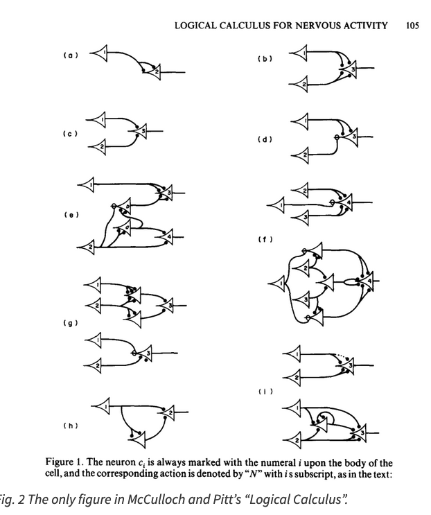
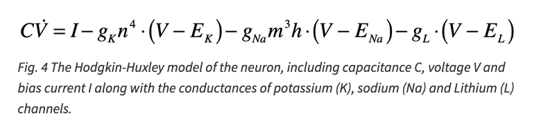
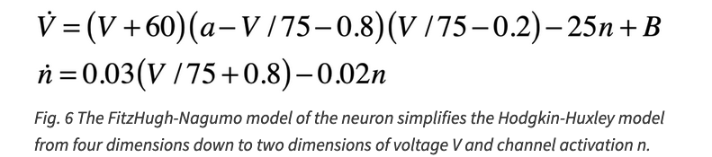
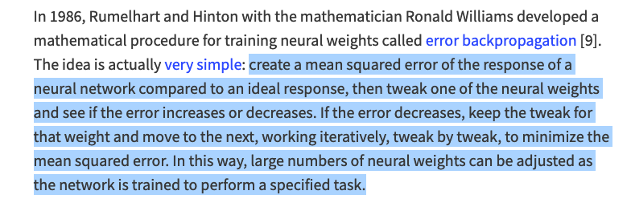

## Development of Neural networks 
(from physics POV): https://galileo-unbound.blog/2025/02/05/a-short-history-of-neural-networks/

1. Ramon y Cajal's general microscopic visualisations (late 19th cent.)

2. McCulloch and Pitts' mathematical models using logical calculus, early 1940s:
*"...simplified the operation of individual neurons to their most fundamental character, envisioning a neural computing unit with multiple inputs (received from upstream neurons) and a single on-off output (sent to downstream neurons) with the additional possibility of feedback loops as downstream neurons fed back onto upstream neurons."*

von Neumann starts working on electric circuits based on these "simplified neural unit which became the basis for discrete logic".

3. Hebbian learning: #hebbian #learning  1949
- During learning, a synapse between two neurons is strengthened when both the pre-synaptic and post-synaptic neurons are firing simultaneously.
- synapses are strengthened when there is collective action among the neurons.
- A collective response of the network strengthens all those synapses that are responsible for the response, while the other synapses that do not contribute, weaken.
- **Hebbian learning becomes basis for ANNs today.**

4. Hodgkin and Huxley's 1952 transporter models (of spiking action potentials):
Created the circuit model emulating currents from non-linear DEs ...

"...The four-dimensional Hodgkin–Huxley model stands as a classic example of the power of phenomenological modeling when combined with accurate experimental observation. Hodgkin and Huxley were able to ascertain not only the existence of ion channels in the cell membrane, **but also their relative numbers, long before these molecular channels were ever directly observed using electron microscopes.** The Hodgkin–Huxley model lent itself to simplifications that could capture the essential behavior of neurons while stripping off the details."

5. Frank Rosenblatt's Perceptron, 1958:
*Adaptive learning demonstrated, based on synaptic weight changes.*
"...Drawing from the work of McCulloch and Pitts, his team constructed a software system and then constructed a hardware model that adaptively updated the strength of the inputs, that they called neural weights, as it was trained on test images. The machine was dubbed the Mark I Perceptron.."

6. Fitzhugh and Nagumo's Oscillator systems, 1960s:

7. Hopfield's 1982 Spin glasses and Recurrent networks:
" content addressable memory"
*It recalls things it has been trained on.* 
It works by repeatedly updating interconnected neurons until the system settles into a stable state that represents a stored pattern. This makes it especially useful for recovering complete information from partial or noisy inputs.
Various different fields, each working to stabilise the weights to 'learnt' patterns.
"...there is a type of disordered magnetic material called a spin glass in which a large number of local regions of magnetism are randomly oriented. In the language of solid-state physics, one says that the potential energy function of a spin glass has a large number of local minima into which various magnetic configurations can be trapped."

8. Backpropagation, 1986:
Parallel processing comes into pciture.
Semi-autonomous neural units share the tasks.
Hebbian learning implemented to strengthen the weights of their interconnections - as an emergent property of the distributed learned weights. 
Tweaking came off as error propagation backward.

9. Yann LeCun's 1989 CNN:
"...By constructing many different “kernel” operators at many different scales, it creates a set of features that capture the nuances of the image in quantitative form that is then processed by training neural weights in downstream neural networks."
Inspired by retina and optical cortex, focus is on multiple focussed regions, kernels, which are then used to access broader areas as well as finer edges.

10. Hinton's 2006 Deep Belief:
Training RBMs (restricted boltzmann machines) to form deep belief networks, which forms basis of today's DNN.

-------------------

