# Refresher's course I:

Let's embark on a refresher of statistical concepts, starting with probability distributions and culminating in hypothesis testing and some of the philosophical debates within the field.

**1. Probability Distributions (PDFs and PMFs)**

Imagine you're flipping a fair coin. There are two possible outcomes: heads (H) or tails (T). The probability of each outcome is 0.5. This is a simple example of a _discrete probability distribution_, specifically a Bernoulli distribution. If we were to plot this, we would have two bars, one for H and one for T, both at a height of 0.5. This is called a _Probability Mass Function (PMF)_, used for discrete variables.

Now, imagine measuring the height of students in a university. Height is a continuous variable. If we were to plot the distribution of heights, it would likely resemble a bell curve, also known as a _normal distribution_ or Gaussian distribution. The curve describes the probability of observing a particular height. The area under the curve between any two height values represents the probability of a student's height falling within that range. This is a _Probability Density Function (PDF)_, used for continuous variables.

A key difference is that with PMFs, the value at a specific point _is_ the probability. With PDFs, the value at a specific point is the _probability density_, and it's the _area_ under the curve between two points that gives the probability.

**Example:** Let's say we're interested in the time it takes for a light bulb to burn out. This could be modeled by an exponential distribution. The PDF would describe the likelihood of the bulb burning out at any given time.

**2. Likelihood and Maximum Likelihood Estimation (MLE)**

The _likelihood_ is the probability of observing the data we have, _given_ a specific set of parameters for our chosen distribution. It's like turning the PDF on its head: instead of fixing the parameters and asking "what's the probability of this outcome?", we fix the outcome and ask "what parameters make this outcome most probable?".

**Example (continued):** Suppose we observe 10 light bulbs burning out at these times (in hours): 100, 150, 200, 250, 300, 350, 400, 450, 500, 550. We assume the burnout time follows an exponential distribution with a parameter λ (lambda), which represents the average burnout rate. The likelihood function is the product of the PDFs of the exponential distribution evaluated at each of our observed burnout times, expressed as a function of λ.

$$ L(\lambda|data) = \prod_{i=1}^{10} \lambda e^{-\lambda x_i} $$

_Maximum Likelihood Estimation (MLE)_ is a method for finding the parameter values that maximize the likelihood function. In our light bulb example, we would find the value of λ that makes the observed burnout times most probable. This is often done by taking the logarithm of the likelihood function (log-likelihood) and then finding its maximum (often by taking the derivative and setting it to zero).

**3. Hypothesis Testing**

Hypothesis testing is a formal procedure for deciding between two competing hypotheses about the world.

- **Null Hypothesis (H0):** A statement we want to disprove (e.g., "the average light bulb burnout time is 200 hours").
- **Alternative Hypothesis (H1 or Ha):** A statement we want to support (e.g., "the average light bulb burnout time is _not_ 200 hours").

We collect data and calculate a _test statistic_, which is a value calculated from the data that summarizes the evidence against the null hypothesis.

**Example (continued):** We could use the sample mean of our burnout times as a test statistic. If the sample mean is very different from 200, it provides evidence against the null hypothesis.

The _p-value_ is the probability of observing a test statistic as extreme as, or more extreme than, the one we observed, _assuming the null hypothesis is true_. A small p-value (typically less than 0.05) provides strong evidence against the null hypothesis.

**4. Confidence Intervals**

A confidence interval provides a range of plausible values for a population parameter. For example, a 95% confidence interval for the average light bulb burnout time means that if we were to repeat our experiment many times, 95% of the calculated confidence intervals would contain the true population mean.

**5. Statistical Analysis and Hypothesis Testing in Practice**

Here's how it all comes together:

1. **Formulate Hypotheses:** State your null and alternative hypotheses.
2. **Choose a Test Statistic:** Select a statistic that is relevant to your hypotheses (e.g., sample mean, t-statistic, chi-squared statistic).
3. **Determine the Distribution of the Test Statistic:** Under the null hypothesis, what is the probability distribution of your test statistic?
4. **Calculate the Test Statistic and p-value:** Calculate the value of your test statistic from your data and determine the associated p-value.
5. **Make a Decision:** If the p-value is small (e.g., < 0.05), reject the null hypothesis. Otherwise, fail to reject the null hypothesis.
6. **Calculate Confidence Intervals:** Provide a range of plausible values for the parameter of interest.

**6. Likelihood Ratio Tests**

A more general approach to hypothesis testing is the _Likelihood Ratio Test (LRT)_. We calculate the likelihood of the data under the null hypothesis and compare it to the likelihood of the data under the alternative hypothesis. The ratio of these likelihoods (or, more commonly, the difference of the log-likelihoods) forms the test statistic. This test statistic is often asymptotically distributed as a chi-squared distribution, allowing us to calculate p-values.

**7. Philosophical Debates and Key Figures**

- **Fisher:** Emphasized p-values as a measure of evidence against the null hypothesis.
- **Neyman-Pearson:** Developed the concept of hypothesis testing with explicit consideration of Type I (false positive) and Type II (false negative) errors. They introduced the concept of a critical region and decision rules.
- **Bayesians:** Use Bayes' theorem to update prior beliefs about parameters in light of new data. They focus on posterior probabilities rather than p-values.

**8. p-values: Controversies and Misinterpretations**

p-values are often misinterpreted. A p-value is _not_ the probability that the null hypothesis is true. It's the probability of observing the data (or more extreme data) _given_ that the null hypothesis is true. There's a growing movement to move away from strict p-value thresholds and towards a more nuanced interpretation of statistical evidence.

**9. Test Statistics: Why?**

Test statistics summarize the information in the data that is relevant to the hypothesis being tested. They allow us to compare the observed data to what we would expect to see under the null hypothesis.

**10. What Statisticians Agree and Disagree On**

Statisticians generally agree on the mathematical foundations of probability and statistics. However, there are ongoing debates about the interpretation and use of statistical methods, particularly regarding p-values, Bayesian vs. frequentist approaches, and the best way to handle complex data.

This overview provides a foundation for understanding key statistical concepts. Remember that statistics is a vast field, and continuous learning is essential.

--------------------------------------------------------

# Refresher's course II:

### **Refresher Course on Statistics**

Let’s build a strong conceptual foundation in statistics step by step. I’ll keep the explanations intuitive and reuse examples to tie the concepts together. Let’s begin!

---

### **1. Probability Density Functions (PDFs)**

A **Probability Density Function (PDF)** describes the likelihood of a random variable taking on a particular value within a given range.

- **Example**: Imagine measuring the **height** of adults in a city. Most people are around the average height (e.g., 170 cm), with fewer being much shorter or taller. This distribution can be modeled using a **normal distribution**.
    
- A PDF tells us **how dense the probabilities are** around each height. For example:
    
    - The probability of someone being exactly **170.000 cm** tall is technically zero because it’s a continuous variable.
    - Instead, we calculate the probability of their height falling in a range, e.g., **between 169 cm and 171 cm**.

---

### **2. The Likelihood Concept**

While PDFs describe probabilities, **likelihood** measures how well a particular model explains observed data.

- **Example**: Suppose you measured 10 people’s heights, and your data fits a normal distribution with a mean of **170 cm** and a standard deviation of **10 cm**. You’re testing whether the true mean height of the population is **170 cm** or **175 cm**.
    
    - Under the hypothesis of a **170 cm mean**, your observed data is more likely.
    - The likelihood gives you a numerical measure of how probable your data is, given this hypothesis.
- **Likelihood vs. Probability**:
    
    - **Probability**: What is the chance of observing a specific outcome given a known model?
    - **Likelihood**: How well does a model explain observed data?

---

### **3. Maximum Likelihood Estimation (MLE)**

MLE finds the **parameter values** (e.g., mean, standard deviation) that make the observed data most likely under a given model.

- **Example**: Continuing with the height example:
    - You collect data on 100 people’s heights.
    - You assume the population follows a normal distribution but don’t know the mean (μ\mu) or standard deviation (σ\sigma).
    - MLE finds the μ\mu and σ\sigma that maximize the likelihood of your data.

**Conceptually**:

- You adjust μ\mu and σ\sigma to "stretch" or "shift" your normal curve until it fits your data as closely as possible.

---

### **4. Hypothesis Testing**

Hypothesis testing helps us decide whether a specific claim about the data is plausible.

- **Null Hypothesis (H0H_0)**: A default assumption (e.g., the mean height is 170 cm).
- **Alternative Hypothesis (H1H_1)**: A competing claim (e.g., the mean height is not 170 cm).

### **Steps in Hypothesis Testing**:

1. **Formulate Hypotheses**:
    
    - H0H_0: The mean height = 170 cm.
    - H1H_1: The mean height ≠\neq 170 cm.
2. **Collect Data**:
    
    - Sample the heights of 100 people.
3. **Calculate a Test Statistic**:
    
    - A numerical summary of the data that helps evaluate H0H_0 (e.g., t-statistic).
4. **Determine a p-value**:
    
    - The p-value is the probability of observing data as extreme as yours under H0H_0.
    - **Small p-value**: Strong evidence against H0H_0.
    - **Large p-value**: Insufficient evidence to reject H0H_0.
5. **Make a Decision**:
    
    - If p<αp < \alpha (e.g., 0.05), reject H0H_0. Otherwise, fail to reject H0H_0.

**Example**:

- Measured sample mean = **171 cm**, standard deviation = **10 cm**, n=100n = 100.
- Test statistic (zz) = (171−170)/(10/100)=1.0(171 - 170) / (10/\sqrt{100}) = 1.0.
- Corresponding p-value ≈ **0.32**.
- Conclusion: Fail to reject H0H_0; there’s no strong evidence the mean height is different from 170 cm.

---

### **5. Fisher vs. Neyman-Pearson Theories**

### **Ronald Fisher**:

- Emphasized the **p-value** as a continuous measure of evidence against H0H_0.
- Believed in "interpreting data" rather than rigid decision-making.

### **Neyman-Pearson**:

- Introduced **hypothesis testing frameworks** with predefined significance levels (α\alpha).
- Emphasized **Type I errors** (rejecting a true H0H_0) and **Type II errors** (failing to reject a false H0H_0).

### **Modern Consensus**:

- Most statisticians use a blend:
    - Fisher's flexible interpretation of p-values.
    - Neyman-Pearson's structured decision-making for clear-cut testing.

---

### **6. Test Statistics**

A **test statistic** measures how far your data deviates from what’s expected under H0H_0.

- **Common Test Statistics**:
    
    - **t-statistic**: For small samples, comparing means.
    - **z-statistic**: For large samples, comparing means or proportions.
    - **χ2\chi^2**: For categorical data or variance testing.
- **Why Use Them?**
    
    - They standardize comparisons across datasets and enable us to calculate p-values.

---

### **7. Confidence Intervals (CIs)**

A **confidence interval** provides a range of plausible values for a parameter (e.g., a mean).

- **Example**:
    - For a sample mean of **170 cm**, a standard deviation of **10 cm**, and n=100n = 100:
        - 95% CI = 170±1.96×(10/100)170 \pm 1.96 \times (10/\sqrt{100}).
        - CI = [168.04 cm, 171.96 cm].
    - Interpretation: If we repeated the experiment, 95% of intervals would contain the true mean.

---

### **8. Comparing Hypotheses**

When comparing models or hypotheses:

- Use the **likelihood ratio test**:
    
    - Compare the likelihoods of two models.
    - Larger ratios favor the better model.
- **Bayesian Approach**:
    
    - Assign prior probabilities to hypotheses and update them with data.
    - Uses **posterior probabilities** for comparisons.

---

### **9. P-Values: Use and Misuse**

- **Why p-values?**: They quantify evidence against H0H_0.
- **Common Misuse**:
    - Treating p<0.05p < 0.05 as a "proof" of an effect.
    - Ignoring effect size or confidence intervals.

---

### **10. What Statisticians Agree and Disagree On**

- **Agreements**:
    - The importance of clear assumptions and transparency.
    - The need for context when interpreting results.
- **Disagreements**:
    - Over-reliance on p-values.
    - Frequentist (e.g., Fisher) vs. Bayesian approaches to inference.

---

### **In Summary**

1. **PDFs** describe how probabilities are distributed.
2. **Likelihoods and MLEs** help fit models to data.
3. **Hypothesis testing** uses test statistics and p-values to evaluate claims.
4. **Confidence intervals** provide plausible parameter ranges.
5. **Test statistics** standardize hypothesis evaluations.
6. P-values are a tool but not the ultimate proof.

Let me know if you’d like more detailed explanations on any part! 😊

----

# Hypothesis testing:

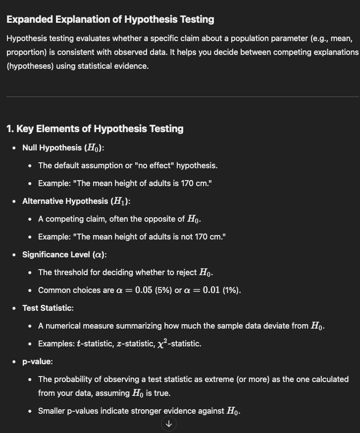

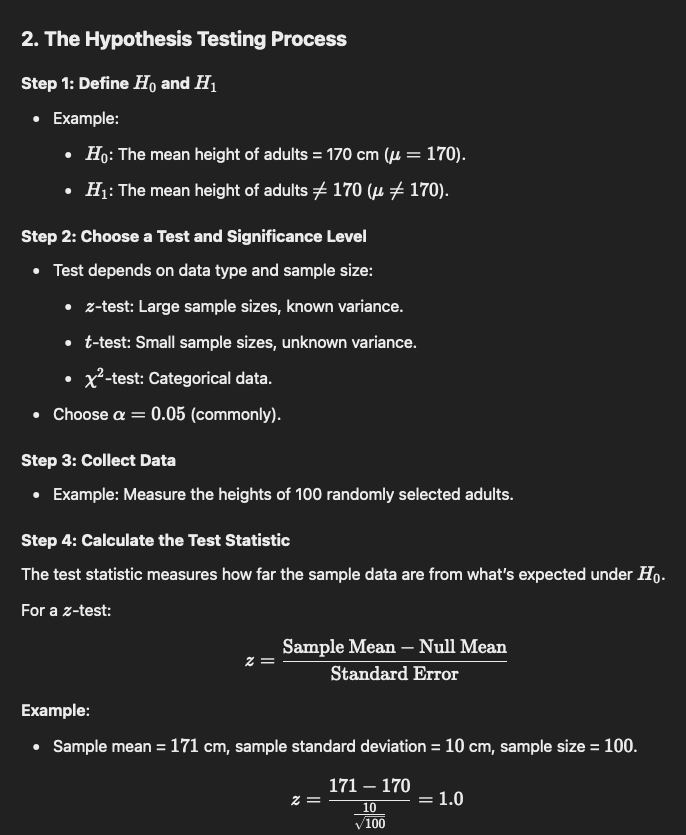

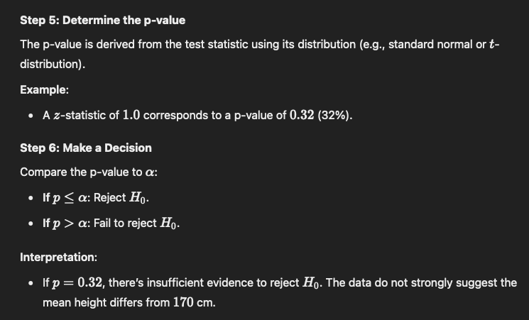

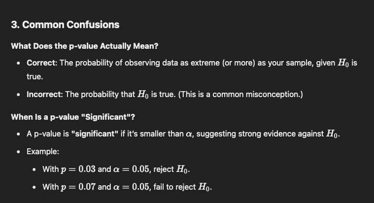

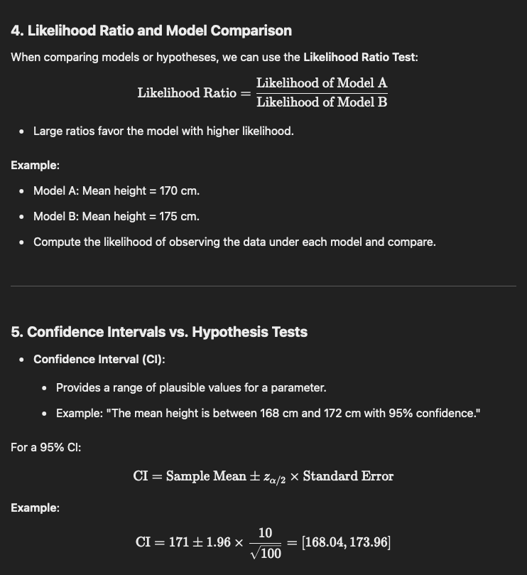

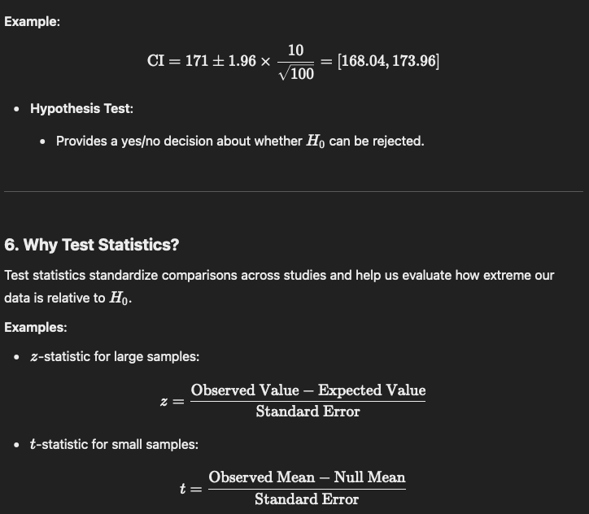

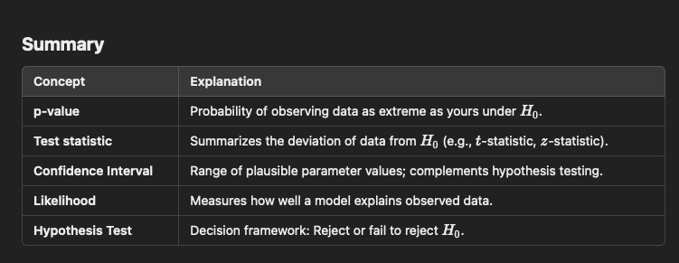

----

# Bias
In statistics, bias refers to the tendency of an estimator (a statistical method used to estimate a population parameter) to consistently **overestimate or underestimate the true value** of the parameter it is trying to estimate.

For example, let's say you want to estimate the average height of all people in a certain population, and you take a random sample of 100 people to do so. If the average height of your sample is consistently higher or lower than the true average height of the entire population, then your estimator is biased.

>[!info]
If you don't know the true value of the population parameter, then it's not possible to determine the bias of an estimator directly. However, you can still investigate the bias of an estimator by looking at how it performs on simulated or hypothetical data.
For example, you can generate a large number of random samples from a population with a known true value of the parameter being estimated, and use these samples to estimate the parameter with your chosen estimator. You can then compare the average value of the estimator across all these samples to the true value of the parameter, and see if there is a consistent overestimation or underestimation of the true value.
This type of simulation-based approach can give you a sense of the bias of your estimator, even if you don't know the true value of the population parameter in real-world situations. However, it's important to keep in mind that the bias of an estimator may vary depending on the specific characteristics of the population being studied, so this type of investigation is most useful when it's done in conjunction with other methods for assessing estimator performance.

The degree of bias is determined by comparing the average value of the estimator over many samples to the true value of the population parameter being estimated. If the average value of the estimator is consistently higher or lower than the true value, then the estimator is said to be biased.

Bias can be caused by a variety of factors, such as sampling methods, measurement error, or modeling assumptions. It's important to identify and account for bias in statistical analysis to ensure accurate and reliable results.

In the context of statistical estimators, a good estimator should have low variance. This means that the estimates it produces should be consistent and not vary widely from sample to sample. An estimator with high variance, on the other hand, produces estimates that are more unpredictable and less reliable.

In the context of statistical estimators, a good estimator should have low variance. This means that the estimates it produces should be consistent and not vary widely from sample to sample. An estimator with high variance, on the other hand, produces estimates that are more unpredictable and less reliable.

**"However, it's important to note that there is often a trade-off between bias and variance when selecting an estimator. An estimator with low variance may have higher bias, meaning that its estimates consistently deviate from the true value of the population parameter being estimated. Conversely, an estimator with low bias may have higher variance, meaning that its estimates are more variable from sample to sample."**

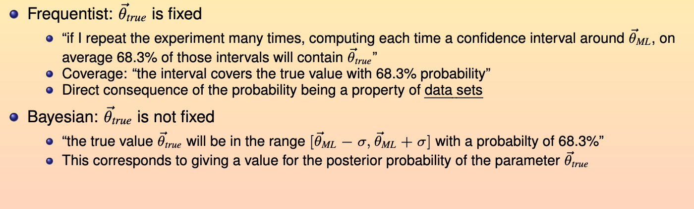

### Roofit and stuffs : 
Roofit is a toolkit used for modeling and fitting data using maximum likelihood estimators. It allows users to define probability density functions (PDFs) to model the data, and provides tools for performing statistical tests, evaluating goodness of fit, and extracting parameter estimates.

RooStats, on the other hand, is a toolkit that builds upon Roofit and provides statistical tools for hypothesis testing, confidence interval construction, and limit setting.

iminuit is a library used for minimizing the value of a function by adjusting the values of its parameters. It provides a Python interface for the popular MINUIT library, which is used extensively in particle physics for fitting data to models.
ROOT includes several sub-packages, such as RooFit, RooStats, and HistFactory, which are used for statistical modeling, hypothesis testing, and histogram-based analysis, respectively. L

# Goodness of fit and MLE :

**Goodness of Fit:**

Goodness of fit is a statistical concept used to evaluate how well a model explains or matches observed data. It helps determine if a given model is a suitable representation of the data.

**Binned and Unbinned Fitting:**

1. **Binned Fitting:** In binned fitting, data is grouped into bins or categories, and a model is fitted to the data in each bin. Common methods for assessing goodness of fit in binned fitting include:
    
    - **Chi-Squared Test:** This method quantifies the difference between observed data and model predictions using the chi-squared statistic. A smaller chi-squared value indicates a better fit.
        
    - **Residuals Analysis:** Calculating the differences (residuals) between observed data and model predictions for each bin. Well-fitting models should have residuals that are approximately normally distributed with a mean of zero.
        
2. **Unbinned Fitting:** In unbinned fitting, individual data points are treated independently, and a model is fitted to the entire dataset. Assessing goodness of fit in unbinned fitting involves different methods:
    
    - **Kolmogorov-Smirnov Test:** Compares the empirical distribution of the data to the cumulative distribution of the model. A high p-value indicates a good fit.
        
    - **Anderson-Darling Test:** Similar to the Kolmogorov-Smirnov test, but sensitive to deviations in the tails of the distribution.
        
    - **Residuals Analysis:** Calculating residuals by subtracting model predictions from observed data points and assessing their distribution.
        

**MLE and Goodness of Fit:**

- MLE (Maximum Likelihood Estimation) is a method for estimating model parameters that maximize the likelihood of observing the data given the model. It is used for parameter estimation rather than a direct goodness-of-fit test.
    
- However, MLE can indirectly contribute to assessing goodness of fit:
    
    - **Likelihood Ratio Test (LRT):** MLE can be used to compare the fit of different models to the data. By comparing the likelihoods of different models, you can perform an LRT to determine if one model fits the data significantly better than another, indirectly assessing goodness of fit.
        
    - **Evaluation of the Likelihood Value:** The likelihood value itself, when evaluated at the maximum likelihood parameter estimates, can provide a measure of how well the chosen model explains the observed data. A higher likelihood value indicates a better fit.
        
    - **Residual Analysis:** MLE parameter estimates can be used to generate predicted values from the model for residual analysis, which can identify deviations from expected patterns, further contributing to the assessment of goodness of fit.
        

While MLE is valuable for parameter estimation, formal goodness-of-fit tests, such as chi-squared tests or Kolmogorov-Smirnov tests, are explicitly designed to assess the agreement between a model and observed data and provide statistical measures of goodness of fit. MLE and likelihood-based methods are often used in conjunction with these tests to refine and validate model fits.

---

Particle physics studies involve various types of statistical fits to analyze experimental data and extract information about fundamental particles and their interactions. Here are some of the different kinds of statistical fits commonly used in particle physics:

1. **Histogram Fitting**:
   - This involves fitting a model to a histogram of observed data. Histograms are often used to represent the distribution of particle properties such as energy, momentum, or mass.
   - Common fit functions include Gaussian functions for peak fitting, exponential functions for background estimation, and more complex models to capture various particle decay processes.

2. **Signal-Background Separation**:
   - In many particle physics experiments, the goal is to distinguish signal events (e.g., particle decays of interest) from background events. This often involves fitting a combination of signal and background models to the data.
   - Fit results are used to estimate the signal yield and background contributions.

3. **Template Fitting**:
   - Template fitting involves comparing observed data to a set of pre-defined templates or Monte Carlo simulations. Templates represent different possible particle processes or signals.
   - The fit aims to determine the contributions of each template to the observed data.

4. **Mass Peak Fitting**:
   - This is a specialized type of histogram fitting used to analyze mass spectra in experiments like those in high-energy physics.
   - It involves fitting peak-shaped functions (e.g., Gaussian functions) to identify and measure particle masses.

5. **Kinematic Fitting**:
   - Kinematic fitting is used to improve the accuracy of measurements in experiments with complex particle decays.
   - It involves adjusting the momenta or positions of detected particles within the uncertainties to satisfy conservation laws and improve the consistency of the data with the expected physics model.

6. **Likelihood Fits**:
   - Maximum Likelihood Estimation (MLE) is a common approach for fitting models to data in particle physics.
   - Likelihood fits involve constructing a likelihood function that measures the agreement between the data and the model. Parameters of the model are adjusted to maximize this likelihood.
   
7. **Bayesian Fits**:
   - Bayesian methods are used to perform parameter estimation and model comparison.
   - These fits involve the application of Bayes' theorem to calculate posterior probability distributions of model parameters, given the observed data.

8. **Profile Likelihood Fits**:
   - In cases where systematic uncertainties are present, profile likelihood fits are used. These fits take into account the effects of systematic uncertainties on the fit results.
   - The likelihood is profiled over the systematic parameters to account for their uncertainties.

9. **Unbinned Fits**:
   - Unbinned fits are used when data points are treated individually, rather than grouped into bins as in histogram fitting.
   - They are often employed for precise measurements where individual events are important.

10. **Multivariate Analysis (MVA)**:
    - MVAs use techniques like neural networks, decision trees, or support vector machines to optimize the separation between signal and background events.
    - MVAs are especially useful in experiments with complex and high-dimensional data.

These are just a few examples of the different types of statistical fits used in particle physics. The choice of fit method depends on the specific experiment, data, and research goals. Particle physicists often employ a combination of these methods to extract valuable information from their data.

----

#statistic  #MLinHEP #MLinParticlePhysics 

# Summary Statistic:

A summary statistic is a single measure that captures some important aspect of a dataset, often used to describe a characteristic of the entire or a portion of the dataset. In essence, it's a way to summarize a large amount of data with a single number or a small set of numbers. Summary statistics are crucial in statistics and data analysis as they provide a quick and easy way to understand complex data. Here are some common types of summary statistics:

### 1. **Measures of Central Tendency:**
   - **Mean (Average):** The sum of all data points divided by the number of points. It provides the central value of the dataset.
   - **Median:** The middle value when all data points are arranged in ascending order. It's useful in skewed distributions as it's not affected by extreme values.
   - **Mode:** The most frequently occurring value in the dataset.

### 2. **Measures of Spread:**
   - **Range:** The difference between the highest and lowest values in the dataset.
   - **Variance:** A measure of how much the data points vary from the mean.
   - **Standard Deviation:** The square root of the variance, representing the average distance of each data point from the mean.
   - **Interquartile Range (IQR):** The range of the middle 50% of the data, calculated as the difference between the 75th and 25th percentiles.

### 3. **Measures of Shape:**
   - **Skewness:** Indicates the asymmetry of the data distribution. Positive skewness means the tail is on the right, negative skewness means it's on the left.
   - **Kurtosis:** Measures the "tailedness" of the distribution, or the presence of outliers.

### 4. **Positional Measures:**
   - **Percentiles/Quartiles:** Values below which a certain percentage of data in the dataset fall. Quartiles are specific percentiles dividing the data into quarters.

### 5. **Counts and Frequencies:**
   - For categorical data, counts (number of occurrences) and frequencies (proportions of each category) are common summary statistics.

### Uses and Importance:
- **Data Understanding:** Summary statistics give a quick overview of the data, helping in initial explorations and understanding.
- **Comparison:** They allow for easy comparison between different datasets or different groups within a dataset.
- **Communication:** They provide a simple way to communicate the characteristics of the data to others without the need for complex explanations or showing all the raw data.

### Limitations:
- **Oversimplification:** Summary statistics can sometimes oversimplify the data, potentially hiding important aspects or nuances.
- **Misleading Interpretations:** Especially in the presence of outliers or skewed distributions, some summary statistics like the mean can be misleading.

In summary, summary statistics are powerful tools for data analysis, providing a concise overview of the data's characteristics, though they should be used judiciously and in context.

---

# Kolmogorov-Smirnov Test:
The Kolmogorov-Smirnov (KS) test is a non-parametric statistical test used to determine if two samples come from the same distribution, or to compare a sample with a reference probability distribution. The test is based on the maximum distance between the empirical distribution functions of the two samples or between the empirical distribution function of a sample and the cumulative distribution function (CDF) of the reference distribution.

### KS-Test Statistic

- **Statistic (D):** The KS test statistic, \(D\), is the maximum absolute difference between the empirical distribution functions of the two samples or between the empirical distribution function and the reference CDF. A larger value of \(D\) indicates a greater discrepancy between the two distributions being compared.

### P-value

- **P-value:** The p-value obtained from the KS test indicates the probability of observing a test statistic as extreme as, or more extreme than, the value computed from the data, assuming that the null hypothesis is true (i.e., the distributions are identical). A low p-value suggests that the observed data are unlikely under the null hypothesis, leading to its rejection.

### Implications

1. **Interpreting the Test Statistic (D):**
   - A **small value** of \(D\) suggests that the distributions of the two samples are similar.
   - A **large value** indicates significant differences between the distributions.

2. **Interpreting the P-value:**
   - If the **p-value is less than a predefined significance level** (commonly 0.05 or 0.01), it suggests that there is statistically significant evidence to reject the null hypothesis, indicating the distributions are different.
   - If the **p-value is greater than the significance level**, there isn't enough evidence to reject the null hypothesis, suggesting the distributions may be considered the same for the purposes of the test.

### Considerations

- **Sample Size:** The power of the KS test can be sensitive to sample size. Larger samples provide more reliable results, as the test becomes more sensitive to differences between distributions.
  
- **Assumptions:** Being a non-parametric test, the KS test does not assume a specific distribution form (e.g., normality) for the data, making it versatile. However, it assumes that the samples are independent and identically distributed within each sample.

- **Use Cases:** The KS test is widely used for goodness-of-fit testing (comparing an observed distribution to a theoretical model) and for comparing two empirical distributions. It's important in fields requiring distributional analysis without strict parametric assumptions.

In summary, the KS test is a valuable tool for statistical analysis to assess the similarity of distributions. However, the interpretation of its outcomes must consider the nature of the data, the test's assumptions, and the context of the research question.

---

# Some bits on Stats and CIs and more: (dumped; needs rework)
1. Sampling versus stat error
Sampling error and statistical error are related concepts in statistics, but they are not exactly the same. Here’s a detailed comparison of the two:

### Sampling Error

**Definition**: Sampling error is the error that arises due to the fact that we are observing a sample rather than the entire population. It represents the difference between the sample statistic (e.g., sample mean) and the actual population parameter (e.g., population mean).

**Causes**:
- The inherent variability in which sample is chosen from the population.
- The size of the sample: smaller samples tend to have larger sampling errors.
- The method of sampling: non-random sampling methods can introduce bias, increasing the sampling error.

**Characteristics**:
- Sampling error is a natural consequence of using a sample to estimate population parameters.
- It can be reduced by increasing the sample size.
- It can be quantified using measures like the standard error of the mean.

**Example**: If you take a sample of 100 people to estimate the average height of all adults in a city, the difference between the sample mean height and the true population mean height is the sampling error.

### Statistical Error

**Definition**: Statistical error is a broader term that encompasses all types of errors that can occur in the process of collecting, analyzing, interpreting, and presenting data.

**Types of Statistical Errors**:
1. **Sampling Error**: As described above.
2. **Measurement Error**: Errors arising from inaccuracies in measuring variables. This can include instrument error, observer error, and respondent error.
3. **Model Error**: Errors due to incorrect or oversimplified models used to analyze the data.
4. **Random Error**: Variability in data that cannot be attributed to any specific source.
5. **Systematic Error (Bias)**: Errors that consistently skew results in a particular direction due to flawed data collection methods, biased sampling, or other systematic issues.

**Characteristics**:
- Statistical error encompasses a wide range of potential inaccuracies in data analysis.
- It includes both random errors (which can often be reduced by increasing sample size or improving measurement techniques) and systematic errors (which require different approaches to identify and correct).

**Example**: In addition to the sampling error in the height estimation example above, if the measuring tape you use is slightly stretched, it will introduce a measurement error. If you only sample people from a specific part of the city where people are generally taller, that introduces a systematic error (bias).

### Summary

- **Sampling Error** is a specific type of statistical error related to the variability inherent in using a sample to estimate a population parameter. It can be minimized by increasing sample size and using proper sampling techniques.
- **Statistical Error** is a broader term that includes sampling error as well as other types of errors such as measurement errors, model errors, random errors, and systematic errors.

Both concepts are crucial in understanding the accuracy and reliability of statistical estimates and analyses.

---

Random error is a broad category of errors that can occur in any type of measurement or data collection process. It does not fall specifically under sampling error but is an overarching concept that includes various sources of variability. Here’s how random error fits into the context of sampling error and high-energy physics:

### Random Error

**Definition**: Random error refers to the variability in measurements or data that cannot be attributed to any specific cause and tends to vary in an unpredictable manner. These errors are inherent in any data collection process.

**Sources**:
- Instrumental fluctuations
- Environmental changes
- Variability in human response (in some types of experiments)

**Characteristics**:
- Random errors are non-systematic and do not consistently skew data in one direction.
- They are usually distributed according to a normal distribution (Gaussian), with most errors being small and the likelihood of larger errors decreasing as they move further from the mean.
- Random errors can be reduced by increasing the number of measurements or observations, as their effects tend to cancel out over multiple trials.

**Example**: In measuring the time of flight of particles in a detector, slight fluctuations in electronic timing or environmental conditions can cause random errors in the measurement.

### Sampling Error

**Definition**: Sampling error is the error that arises because we are observing a sample rather than the entire population. It represents the variability in the sample statistic from the true population parameter due to the random nature of sampling.

**Relationship to Random Error**:
- Sampling error can be considered a type of random error, as it arises from the random selection of a sample.
- However, sampling error specifically refers to the variability due to the sampling process, while random error can encompass a broader range of variability sources.

### Random Error in High-Energy Physics

In high-energy physics, random errors are a significant consideration, but they are often discussed in more specific terms related to the measurements and data analysis:

1. **Statistical Uncertainty**: This is analogous to random error and refers to the uncertainty in measurements due to the finite number of events (sample size). For example, the statistical uncertainty in counting the number of events in a particle detector.
2. **Systematic Uncertainty**: This includes errors that are not random, such as biases in the measurement process, calibration errors, or theoretical model uncertainties.

### Example in High-Energy Physics

- **Statistical (Random) Uncertainty**: When measuring the cross-section of a particular particle interaction, the finite number of observed events leads to a statistical uncertainty. This is a type of random error.
- **Systematic Uncertainty**: If there is a consistent bias in the detector calibration that shifts all measurements in one direction, this is a systematic error.

### Summary

- **Random Error**: A broad category of unpredictable, non-systematic variability in measurements. In high-energy physics, this is often referred to as statistical uncertainty.
- **Sampling Error**: A specific type of random error arising from the variability in using a sample to estimate a population parameter.
- **In High-Energy Physics**: Both statistical (random) uncertainties and systematic uncertainties are considered, with random errors often being a major component of the overall measurement uncertainty.

In high-energy physics, understanding and minimizing both random and systematic uncertainties are crucial for precise and accurate measurements, but random errors (statistical uncertainties) remain a fundamental aspect of the analysis due to the inherently stochastic nature of particle interactions and detections.

----

### Random Error in High-Energy Physics

- **Statistical Uncertainty**: Random variability due to finite sample size.
- **Systematic Uncertainty**: Non-random biases or errors in measurement.
- **Random Error**: Generally refers to statistical uncertainties.

### Sampling Error and Statistical Error

- **Sampling Error**: Difference between sample statistic and population parameter.
- **Statistical Error**: Broad term, includes all types of errors in data collection and analysis (sampling, measurement, model errors).

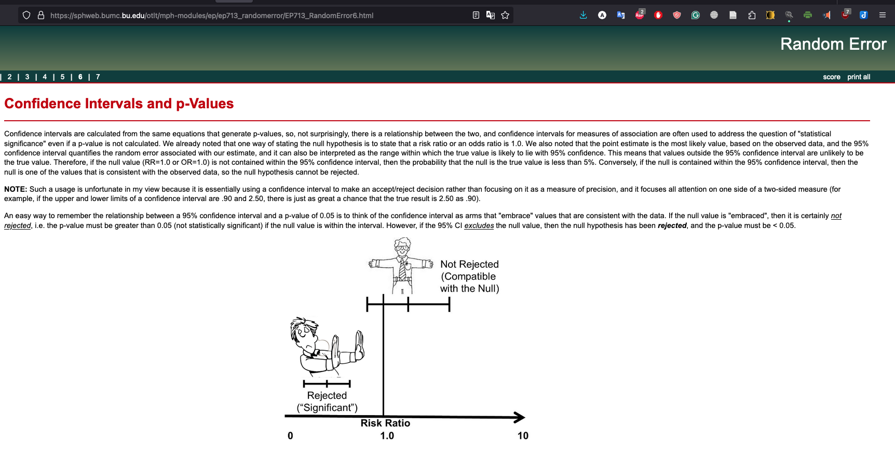

A bit on this website: /sphweb.bumc.bu.edu/otlt/mph-modules/

----

***a 95% confidence interval means that if the same population were sampled on numerous occasions and confidence interval estimates were made on each occasion, the resulting intervals would contain the true population parameter in approximately 95% of the cases, assuming that there were no biases or confounding. However, people generally apply this probability to a single study.

#pvalue

***If the p-value is 0.05 or less, reject the null hypothesis and accept that there is a statistically significant effect.

The p-value indicates the probability of observing the data, or something more extreme, assuming the null hypothesis is true. A low p-value suggests that the observed difference is unlikely to have occurred by random chance, implying that the alternative hypothesis may be true.

---

## Another reference:

https://pages.stat.wisc.edu/~shao/stat610/Casella_Berger_Statistical_Inference.pdf

----

## Estimation theory:

Branch that deals with estimating the values of parameters based on measured empirical data that has a random component. 

----------

# Z-score
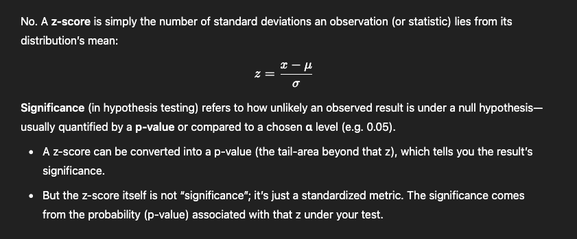
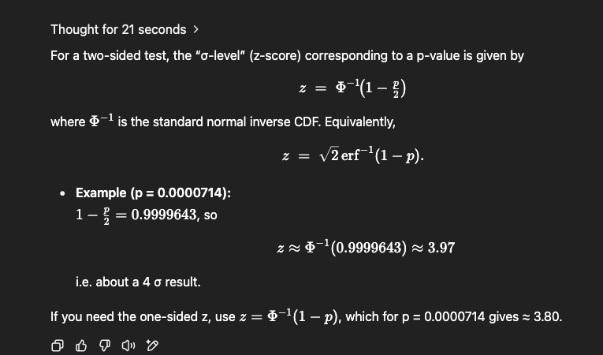

Git project has more details - /Users/arpanghosal/Work/Software_tutorials/gitprojects/Pycharm-Python-projects/Statistics_basics.ipynb 

---

# Bayes' paper on theorem (royal society ppr):
### **An Essay Towards Solving a Problem in the Doctrine of Chances**

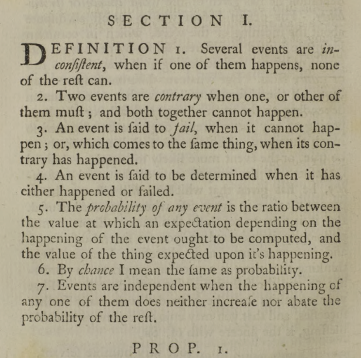

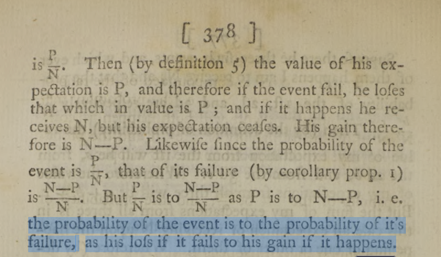

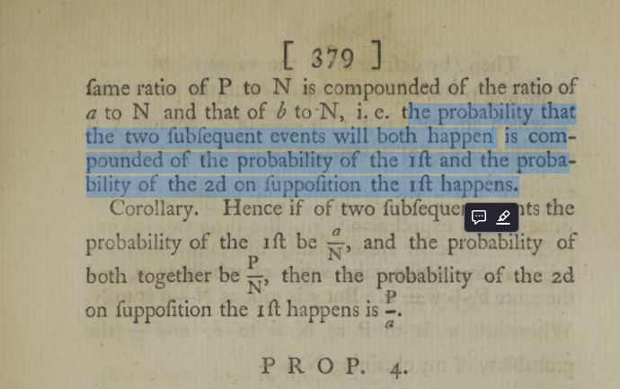

Solving the problem using balls thrown onto a square table:
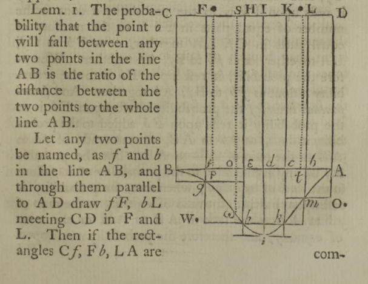

'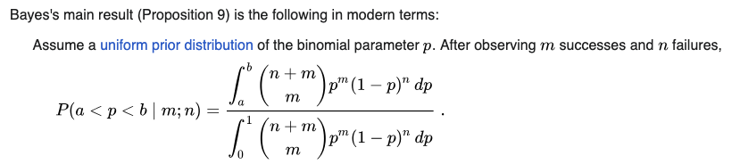
'

However, *Bayes stated his question in a manner that suggests a frequentist viewpoint*: he supposed that a ball is thrown at random onto a square table (this table is often misrepresented as a billiard table, and the ball as a billiard ball, but Bayes never describes them as such), and *considered further balls that fall to the left or right of the first ball with probabilities p and 1 − p* . The algebra is of course identical no matter which view is taken. - Wiki

Of course, later on Kolmogorov and set theory mathematicians would curb most of the verbosity down....

"_The purpose I mean is, to show what reason we have for believing that there are in the constitution of things fixt laws according to which things happen, and that, **therefore, the frame of the world must be the effect of the wisdom and power of an intelligent cause; and thus to confirm the argument taken from final causes for the existence of the Deity._**" - Richard Price on intro to the essay. #religion 

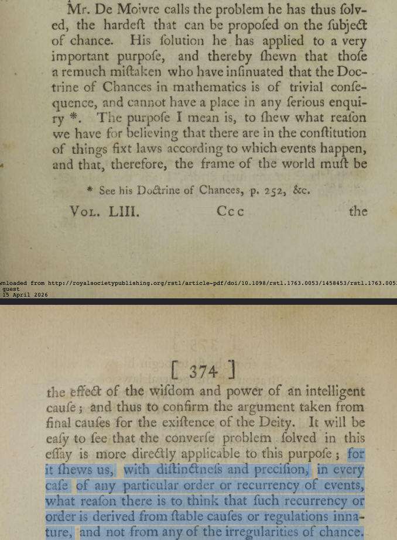

---

